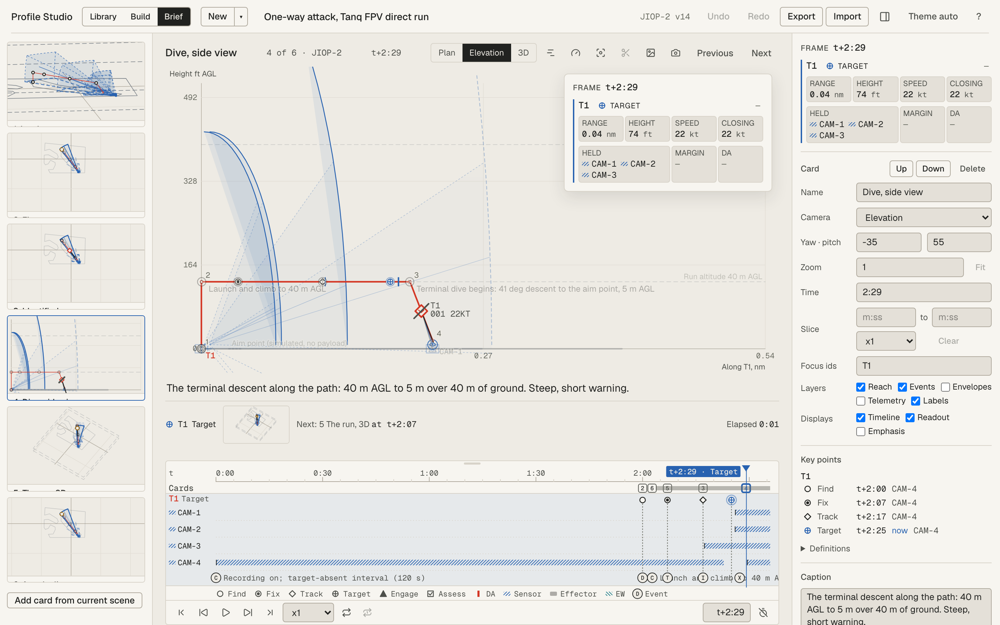
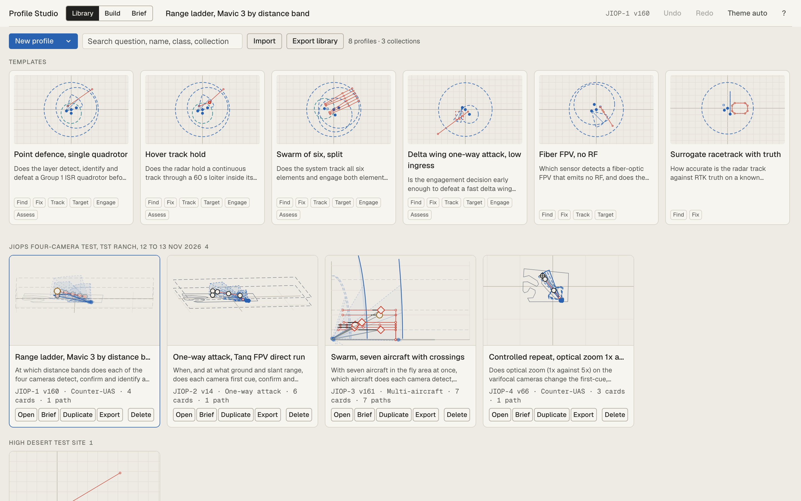
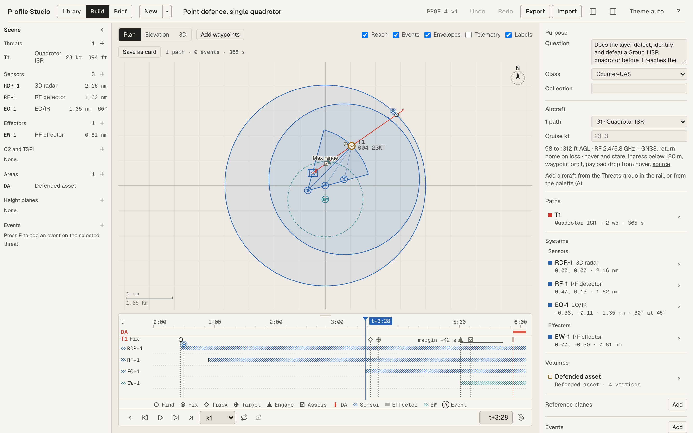
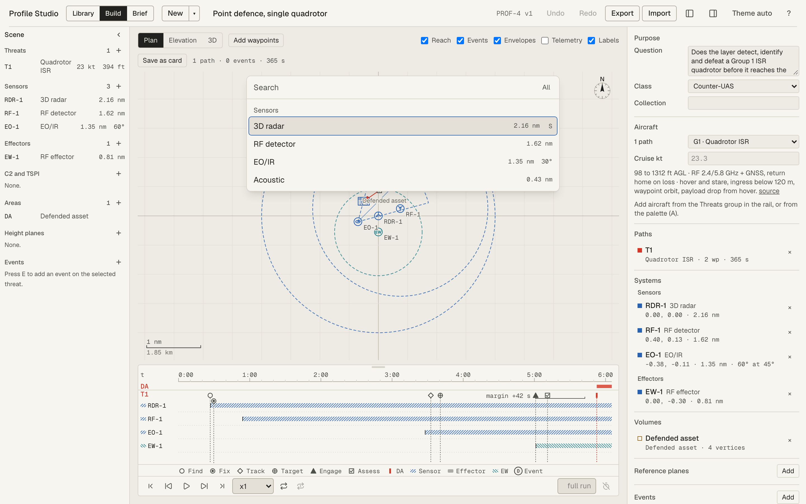
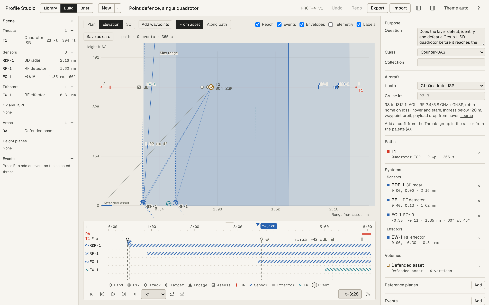
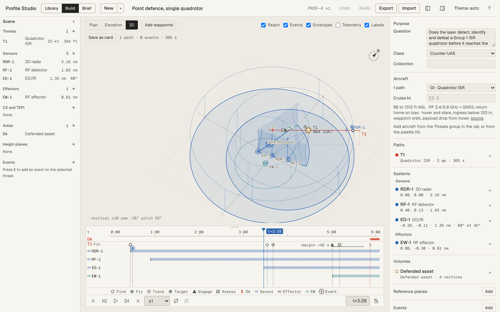

# Profile Studio

A counter-UAS test-profile planner. You build a test profile on a map, check it in Plan,
Elevation and 3D, save views as cards and brief the profile to the test team from the app.

Each profile states one question, the data products that answer it and its measures of
performance. Measures use DroneScore IDs and names, grouped by F2T2EA step (Find, Fix, Track,
Target, Engage, Assess). Profile Studio plans tests. It does not run or score them.



## Contents

- [Quick start](#quick-start)
- [The three workspaces](#the-three-workspaces)
- [Shipped profiles and templates](#shipped-profiles-and-templates)
- [Keyboard shortcuts](#keyboard-shortcuts)
- [Import and export](#import-and-export)
- [Where your work is saved](#where-your-work-is-saved)
- [For developers](#for-developers)

## Quick start

You need Node 22 and npm.

```sh
git clone https://github.com/caseyvalkryn/profile-studio.git
cd profile-studio
npm ci
npm run dev -- --port 5174 --strictPort
```

Open <http://localhost:5174/>. The Library opens with the shipped profiles and the templates.

Use port 5174 every time. The app saves your profiles in the browser for that address only.
A different port shows a different library.

**First profile in five steps:**

1. In the Library, click a template, for example **Point defence, single quadrotor**. Build
   opens with a copy.
2. Drag a sensor ring or a waypoint on the board. The drag label shows the new value and the
   largest change it causes downstream.
3. Press **T** to turn on the time cursor. Press **]** to step through the F2T2EA key points.
4. Press **C** to save the view as a card.
5. Click **Brief** in the top bar. Your card is on the stage.

## The three workspaces

The top bar switches between Library, Build and Brief. **Cmd+K** opens the command palette in
every workspace. Press **?** for the shortcut sheet.

### Library



The Library is the start screen. It shows:

- **New profile.** Creates "Untitled profile" with a default site and one defended asset. The
  arrow on the button opens **From template**.
- **Templates.** Read-only profiles. A click opens a new copy in Build. Each card shows the
  question and the F2T2EA steps the template exercises.
- **Saved profiles.** Grouped by collection, newest first. Each card has Open, Brief,
  Duplicate, Export and Delete. Delete has undo.

Press **/** to search by question, name, class or collection.

### Build



Build is where you make the profile. The layout is:

- **Rail (left).** Every asset in the profile, grouped as Threats, Sensors, Effectors, C2 and
  TSPI, Areas, Height planes and Events. Drag an item from the rail onto the board to place
  it. A threat drop starts a flight path: click to add waypoints, double-click or Enter to
  end, Escape to cancel.
- **Board (centre).** The map. The bar above it holds the view segment, **Add waypoints**,
  the five layer toggles (Reach, Events, Envelopes, Telemetry, Labels) and **Save as card**.
- **Timeline (under the board).** One lane per threat with its F2T2EA key points, one row per
  sensor and effector with its coverage windows, and the authored events. Drag on the axis to
  scrub. Shift and drag to set a loop.
- **Inspector (right).** Every object in the profile by section: Purpose, Aircraft, Paths,
  Systems, Volumes, Reference planes, Events, Data products, Measures of performance and Site.
  Each field edit is one undo step.

Right-click any object for its actions: set range, make sector or omni, set altitude, hold,
split, merge and more. Each menu item shows its shortcut.

**Quick-add.** Press **A** to add any asset by name. **S** opens it on Sensors, **V** on
Areas, **E** on Events. Each row shows the catalog values.



**Views.** Press **1**, **2** or **3**.

| Key | View      | Use it to                                                                                                                                             |
| --- | --------- | ----------------------------------------------------------------------------------------------------------------------------------------------------- |
| 1   | Plan      | Place and move assets. North is up.                                                                                                                   |
| 2   | Elevation | Check heights. **From asset** shows range from the origin with sensor elevation limits. **Along path** shows distance along the selected flight path. |
| 3   | 3D        | Look at the whole scene and the sensor coverage volumes. Drag to orbit. 3D does not edit.                                                             |





**Focus.** Select objects and press **H** to make them the focus. The rest of the scene draws
faint. **Shift+H** cycles the rest between faint, hidden and dim. A card stores the focus.

**Units.** The display uses nm, ft AGL and kt. Press **U** for km, m and m/s. Time shows as
`t+m:ss`.

### Brief

Brief presents the profile as cards (see the screenshot at the top of this page).

- **Card strip (left).** The deck. Up and Down move the current card. Delete has undo.
- **Stage (centre).** The current card at its view, time, layers and focus. Wheel to zoom,
  drag to pan, and in 3D drag to orbit. Each change is one undo step on the card.
- **Notes (right).** The card fields, the frame readout for each threat in focus (range,
  height, speed, closing speed, the systems that hold it, margin) and the key points list.
  Click a key point to move the time there.

Useful Brief keys: **Right** or **Space** next card, **Left** previous card, **Q** puts the
question on the stage, **E** turns on emphasis, **P** plays the card's slice, **L** shows or
hides the timeline.

**Slices.** A slice is a time range on a card. Set a loop on the timeline (Shift and drag),
then click the Scissors button in the stage head. **P** plays the slice.

## Shipped profiles and templates

The app ships the profiles in `profiles/saved/`. On start, the app adds each one that your
browser does not have, and updates each one your browser holds in an older version. Your own
edits made after the shipped version stay.

| Id     | Profile                                       | Cards |
| ------ | --------------------------------------------- | ----- |
| JIOP-1 | Range ladder, Mavic 3 by distance band        | 4     |
| JIOP-2 | One-way attack, Tanq FPV direct run           | 6     |
| JIOP-3 | Swarm, seven aircraft with crossings          | 7     |
| JIOP-4 | Controlled repeat, optical zoom 1x against 5x | 3     |
| PROF-1 | Swarm of six, split                           | 0     |
| PROF-2 | TST Ranch (site areas)                        | 0     |
| PROF-3 | UAS Fly Area (site areas)                     | 0     |
|        | Point defence, single quadrotor               | 0     |

JIOP-1 to JIOP-4 plan the JIOPs four-camera test at the TST Ranch, 12 to 13 November 2026.
`profiles/jiop/README.md` gives the camera planning model and the generator.

Templates:

| Template                               | Question                                                                        |
| -------------------------------------- | ------------------------------------------------------------------------------- |
| Point defence, single quadrotor        | Does the layer detect, identify and defeat a Group 1 ISR quad before the asset? |
| Hover track hold                       | Does the track hold through a 60 s hover?                                       |
| Swarm of six, split                    | Does the system track six and engage both elements?                             |
| Delta wing one-way attack, low ingress | Is the engagement decision early enough for a 46 m/s attack?                    |
| Fiber FPV, no RF                       | What detects a threat that emits nothing?                                       |
| Surrogate racetrack with truth         | How accurate is the track against truth?                                        |
| Detection range sweep                  | How does detection range change with threat altitude?                           |
| Blank                                  |                                                                                 |

Thresholds in the templates are planning values. Set your own in the Inspector.

## Keyboard shortcuts

Press **?** in the app for the full sheet for the current workspace.

| Key                | Action                                              |
| ------------------ | --------------------------------------------------- |
| Cmd+K              | Command palette                                     |
| Cmd+N              | New profile                                         |
| Cmd+Z, Shift+Cmd+Z | Undo, redo                                          |
| 1, 2, 3            | Plan, Elevation, 3D                                 |
| A                  | Quick-add (S Sensors, V Areas, E Events)            |
| C                  | Save as card                                        |
| T                  | Time cursor on or off                               |
| [ , ]              | Previous or next key point                          |
| Space              | Play or pause                                       |
| Left, Right        | Step time 1 s (with Shift, 10 s)                    |
| H, Shift+H         | Focus the selection; cycle the focus level          |
| Shift+1 to Shift+5 | Layers: Reach, Events, Envelopes, Telemetry, Labels |
| F                  | Fit view                                            |
| M                  | Measure tool                                        |
| G                  | Grid snap on or off (Alt bypasses every snap)       |
| U                  | Units toggle                                        |
| I                  | Inspector (Notes in Brief) open or closed           |
| \                  | Both side panels open or closed                     |
| Delete             | Delete the selection                                |
| Escape             | Cancel the current action, then clear the selection |

## Import and export

| To                                  | Do this                                                                                                                              |
| ----------------------------------- | ------------------------------------------------------------------------------------------------------------------------------------ |
| Import a profile                    | Library, **Import**. Accepts Profile Studio JSON (v5 to v8) and legacy v4 JSON. You can also drop the file on the Library.           |
| Start a profile from a site file    | Library, **Import**, then choose a KML or KMZ file. Each polygon becomes a range area.                                               |
| Add a site file to the open profile | Build, Cmd+K, **Import a site file**, or drop the KML or KMZ file on the board.                                                      |
| Export one profile                  | **Export** in the top bar, or Export on the Library card. The JSON includes the resolved waypoint times for the range's VAL tooling. |
| Export the whole library            | Library, **Export library**.                                                                                                         |
| Print the brief                     | Brief, Cmd+K, **Print brief**. Gives one page per card with its render, caption and notes. Save as PDF from the print dialog.        |
| Save one stage image                | Brief, the image button in the stage head (**Save a screenshot**). Saves a PNG at twice the stage size.                              |

## Where your work is saved

Profiles autosave to the browser's IndexedDB for the address you opened. There is no server
and no account. To keep or share a profile, export it as JSON.

- Clearing site data for `localhost:5174` deletes your local edits. The shipped profiles come
  back on the next start.
- A profile you edit in one browser does not appear in another browser. Export it and import
  it there.

## For developers

```sh
npm run gate          # typecheck, lint, unit tests, build, Playwright e2e
npm run format        # Prettier (not part of the gate)
npm run legacy:smoke  # the frozen ES5 app's cases
```

Run the gate before you call a change done. Port 5173 belongs to RangeBoard. Use 5174 for dev;
the e2e suite uses 5175.

| Path            | Contents                                                                                                |
| --------------- | ------------------------------------------------------------------------------------------------------- |
| `src/engine/`   | Geometry, preview and derived values. No DOM.                                                           |
| `src/domain/`   | Types, zod schema (`profile-studio/8`), catalog, templates, migrations, KML and KMZ parsing             |
| `src/state/`    | Document store with undo, UI store, IndexedDB persistence                                               |
| `src/commands/` | The one command registry for menus, palette, keys and the shortcut sheet                                |
| `src/board/`    | The SVG board renderer: cameras and layers                                                              |
| `src/features/` | Shell, Library, Build, Brief, timeline                                                                  |
| `e2e/`          | Playwright specs, one per acceptance item in the spec                                                   |
| `profiles/`     | The JIOPs profiles and generator, and the saved library the app ships                                   |
| `docs/`         | `spec.md` (what is built), `design-principles.md`, `decisions.md`, `reference/` (DroneScore, JIATF-401) |
| `legacy/`       | The frozen v4 app and `mockup-v3.html`, the design direction                                            |

Read `CLAUDE.md` for the working conventions and `docs/reference/dronescore-measures.md`
before you add or rename a measure.
